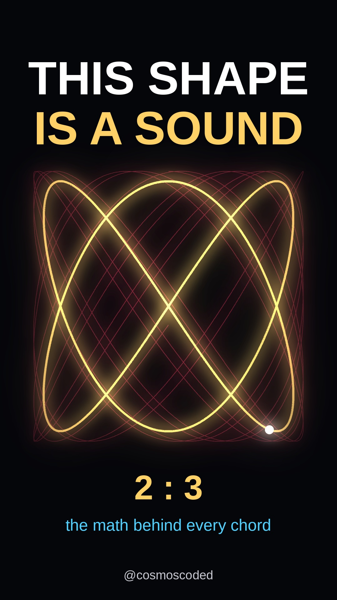

# This circle is a sound — Lissajous harmony

[](https://youtube.com/shorts/Agl-joxK8Cw)

**Watch:** [youtube.com/shorts/Agl-joxK8Cw](https://youtube.com/shorts/Agl-joxK8Cw) · 45.7 s · 1080×1920 · 30 fps

## Idea

Feed two notes into the x and y axes and a dot draws a shape. Simple frequency ratios — the chords that sound sweet — close into clean loops. The tritone, ratio √2, is irrational, so its curve never closes. The video and its music are generated from the same equations.

$$x(\theta) = \sin(a\theta), \qquad y(\theta) = \sin(b\theta + \varphi)$$

| Section | Ratio a : b | Notes (Hz) |
|---|---|---|
| Unison | 1 : 1 | 220 : 220 |
| Octave | 1 : 2 | 220 : 440 |
| Perfect fifth | 2 : 3 | 220 : 330 |
| Perfect fourth | 3 : 4 | 220 : 293 |
| Major third | 4 : 5 | 220 : 275 |
| Tritone | 1 : √2 | 220 : 311 |

## How it is built

- **Sound:** the two sine tones are the curve's x and y frequencies, played left and right, with a soft pad, kick, hat and clap on an 84 BPM grid. Continuous phase (no clicks), a riser into one silent beat at the tritone peak, loudness-normalised to −14 LUFS. 100% original audio.
- **Picture:** each section snaps on a bar line; every kick flashes the curve; a slow phase drift (0.12 Hz detune) makes closed shapes rotate; the tritone keeps winding from 6 to 40 turns.
- **Text:** story beats come from the section schedule with a 3 s minimum on screen.
- **Loop:** ends on the same circle it starts with.

## Run it

```bash
pip install -r ../requirements.txt     # plus ffmpeg and fonts-liberation
python lissajous_harmony.py            # -> lissajous_harmony.mp4 (~2 min on 2 CPUs)
python make_thumbnail.py               # -> assets/cover_9x16.png, assets/cover_16x9.png
```

Every parameter (BPM, ratios, colours, layout, mix levels) is a global at the top of each script.

## Files

| File | What it is |
|---|---|
| `lissajous_harmony.py` | Renders the Short: picture, music and text from one schedule |
| `make_thumbnail.py` | Draws the cover from the same equations |
| `assets/cover_9x16.jpg` | Published cover |
| `assets/preview_frames.jpg` | Six frames used for the quality check |
