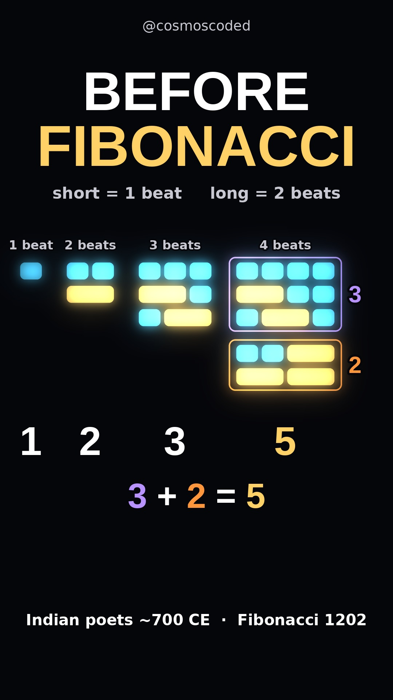

# Poets found this before Fibonacci

[](https://youtube.com/shorts/6nqwPUfpbro)

**Watch:** [youtube.com/shorts/6nqwPUfpbro](https://youtube.com/shorts/6nqwPUfpbro) · 58 s · 1080×1920 · 30 fps

## Idea

Take two sounds: a **short** one (1 beat) and a **long** one (2 beats). How many ways can you fill *n* beats?

| Beats | Ways |
|---|---|
| 1 | 1 |
| 2 | 2 |
| 3 | 3 |
| 4 | 5 |
| 5 | 8 |
| 6 | 13 |

Every rhythm ends in either a short or a long. So the ways to fill 4 beats are: every 3-beat way **+ a short** (3 of them), and every 2-beat way **+ a long** (2 of them): 3 + 2 = 5. In general

$$N_n = N_{n-1} + N_{n-2}$$

which is the Fibonacci sequence. Indian scholars of Sanskrit metre wrote this rule down while counting poem rhythms: Virahāṅka (~700 CE) and Hemachandra (~1150 CE), centuries before Fibonacci's *Liber Abaci* (1202). The counting of short/long patterns goes back to Pingala's *Chandaḥśāstra* (c. 3rd–2nd century BCE).

The video ends on a question: how many ways for 8 beats? (Answer: 34.)

## How it is built

- **Picture:** plain blocks — cyan = short, gold double-width = long — in one column per beat count. The 4- and 5-beat columns are built on screen from the two previous columns, with the "+ short" and "+ long" groups bracketed in their own colours.
- **Sound:** 120 BPM grid; the drum plays exactly the block lit on screen ("ta" / "taa"); pitches come from the counts. Continuous phase, a riser into one silent beat, loudness-normalised to −14 LUFS. 100% original audio.
- **Text:** one plain caption per idea, each on screen for at least 5 s, timed from the same beat schedule.
- **Loop:** the last bar returns to the opening ta–taa.

## Sources

- P. Singh, "The so-called Fibonacci numbers in ancient and medieval India", *Historia Mathematica* 12 (1985)
- K. Plofker, *Mathematics in India* (Princeton, 2009)
- Quanta Magazine, "The Musical, Magical Number Theorist" (2014) — Manjul Bhargava on Hemachandra numbers

## Run it

```bash
pip install -r ../requirements.txt     # plus ffmpeg and fonts-liberation
python pingala_rhythm.py               # -> pingala_rhythm.mp4, preview_frames.jpg, beats.json
python make_thumbnail.py               # -> assets/cover_9x16.jpg, assets/cover_16x9.png
```

Every parameter (BPM, colours, layout, mix levels, section lengths) is a global at the top of each script.

## Files

| File | What it is |
|---|---|
| `pingala_rhythm.py` | Renders the Short: picture, music and text from one schedule |
| `make_thumbnail.py` | Draws the cover; asserts every number it shows |
| `assets/cover_9x16.jpg` | Published cover |
| `assets/preview_frames.jpg` | Six frames used for the quality check |
