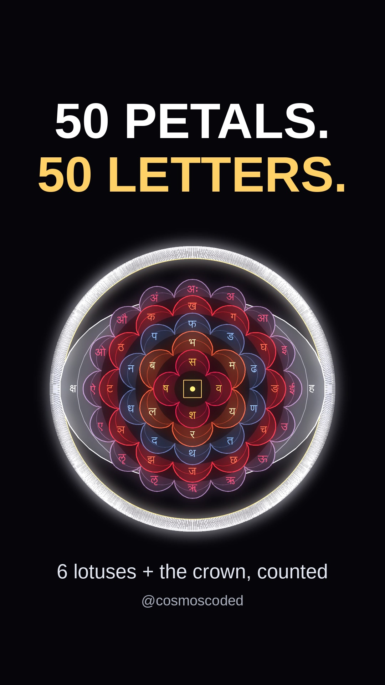

# Count the petals. (the 7 chakras as one mandala)

[](https://youtube.com/shorts/PtxJZ1z9p-8)

**Watch:** [youtube.com/shorts/PtxJZ1z9p-8](https://youtube.com/shorts/PtxJZ1z9p-8) · 42 s · 1080×1920 · 30 fps · series: *Ancient Code*

## Idea

In the *Ṣaṭ-cakra-nirūpaṇa* (Pūrṇānanda, 1577; translated by Arthur Avalon in *The Serpent Power*, 1919) the six lotuses up the spine have 4, 6, 10, 12, 16 and 2 petals, and every petal carries one Sanskrit letter:

$$4 + 6 + 10 + 12 + 16 + 2 = 50$$

That is the alphabet as this text counts it (the *mātṛkā*; some lists count 51). The crown lotus (Sahasrāra) has 1000 petals: 50 letters going round 20 times.

$$1000 = 50 \times 20$$

This is the structure of one text, drawn exactly. It is not a science claim, and other traditions count the chakras differently.

## Petals, letters and colours (verse by verse)

| Lotus | Petals | Petal colour | Letters | Letter colour | Verse |
|---|---|---|---|---|---|
| Mūlādhāra | 4 | crimson (red lotus) | व श ष स | shining gold | 4 |
| Svādhiṣṭhāna | 6 | vermilion | ब भ म य र ल | lightning | 14 |
| Maṇipūra | 10 | heavy-laden rain clouds | ड ढ ण त थ द ध न प फ | blue lotus | 19 |
| Anāhata | 12 | bandhūka flower (deep red) | क … ठ | vermilion | 22 |
| Viśuddha | 16 | smoky purple | the 16 vowels अ … अः | crimson | 28 |
| Ājñā | 2 | white like the moon | ह क्ष | white | 32 |
| Sahasrāra | 1000 | whiter than the full moon, filaments the colour of the young sun | अ … ल (no क्ष), 20 rounds | white | 40 |

The earth square in the root lotus is yellow (verse 5). Verse text: [wisdomlib.org, Ṣaṭ-cakra-nirūpaṇa (Avalon)](https://www.wisdomlib.org/hinduism/book/shat-cakra-nirupana-english/d/doc1144817.html).

## How it is built

- **Picture:** every ring is one polar curve, one petal per arch:

$$r(\theta) = R + a\,\left|\sin\!\left(\tfrac{n\theta}{2}\right)\right|^{p}$$

  with $n$ = petal count, $p = 0.6$ for round lotus petals and $p = 3$ for the two narrow Ājñā wings. The letters (Lohit Devanagari) pop onto the petals one by one while a counter keeps the running total.
- **Loop:** each ring spins by whole petal-widths, so the last frame lands back on the first.
- **Music:** generated by the script. A lotus with $n$ petals plays $n \times 55$ Hz (the harmonic series of A1), one pluck per petal. The crown is a shimmer of high harmonics, and the whole track is normalised to −14 LUFS with one silent beat before the payoff.

## Run

```bash
pip install -r ../requirements.txt
# system: ffmpeg, fonts-liberation, fonts-lohit-deva
python chakra_mandala.py            # video + upload copy + preview_frames.jpg + audio report
python chakra_mandala.py --sheet    # 6-frame preview sheet only
python make_cover.py                # covers into assets/
```

| File | What it is |
|---|---|
| `chakra_mandala.py` | the whole Short: geometry, letters, captions, music, render |
| `make_cover.py` | 9:16 and 16:9 covers |
| `assets/` | covers and the 6-frame preview sheet |
