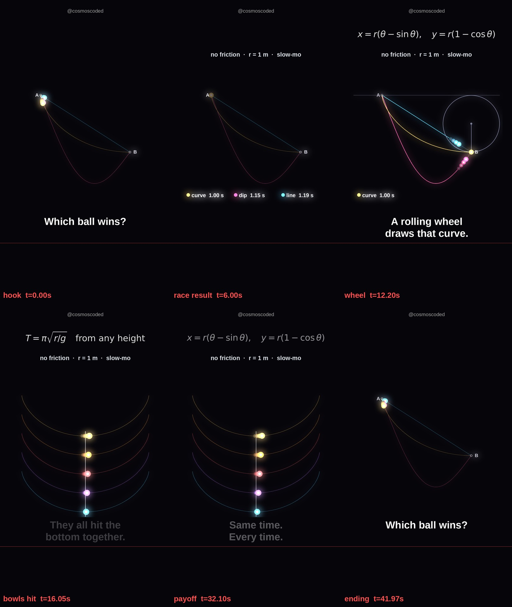

# Which ball wins? (the brachistochrone and the tautochrone)

Watch: youtube.com/shorts/CY2Tu5Jc8YA · 42 s · 1080×1920 · 30 fps · series: Weird Physics



## Idea

Three balls slide from A to B with no friction: a straight line, a deep steep dip, and a cycloid

$$x = r(\theta - \sin\theta), \qquad y = r(1 - \cos\theta)$$

The straight line is the shortest path but the slowest. The cycloid is the fastest of all paths (the brachistochrone, Johann Bernoulli's 1696 challenge, answered in 1697).

Second trick: on the same curve, a ball let go from rest at any height reaches the bottom after the same time (the tautochrone, Huygens, *Horologium Oscillatorium*, 1673):

$$T = \pi\sqrt{r/g}$$

## Numbers (computed, not typed)

The script integrates the travel time along each track, from rest, with $v = \sqrt{2gy}$:

$$t = \int \frac{ds}{\sqrt{2gy}}$$

| Track | Shape | Time (r = 1 m, g = 9.81 m/s²) |
|---|---|---|
| curve | cycloid | 1.003 s (= π√(r/g)) |
| dip | y = 2x/π + 2 sin x | 1.152 s |
| line | straight A → B | 1.189 s |

The script asserts that the cycloid time matches π√(r/g) to 0.5% and that curve < dip < line.

## How it is built

- **Race:** each ball moves along its track by inverting the integrated t(s). On the cycloid the parameter runs evenly, θ = t√(g/r), so the ball is exactly the rim point of a wheel rolling at constant speed. The wheel is drawn in the fourth race.
- **Tautochrone:** 5 stacked cycloid bowls. Arc length from the bottom is s = 4r cos(θ/2), and the motion is simple harmonic, s(t) = s₀ cos(t√(g/4r)). All 5 balls cross the bottom together every 2T.
- **Slow motion:** about ×2, chosen so T lands on exactly 4 beats at 120 BPM.
- **Loop:** the races repeat every 7 beats, and the last race starts 1 beat before the end, the same as the first one, so the last frame runs into the first.
- **Music:** generated by the script. The winner rings on the beat, the losers blip when they finish, and all 5 bowl balls landing together play one pentatonic chord. The track is normalised to −14 LUFS, with one silent beat before the payoff.

## Run

```
pip install -r ../requirements.txt
# system: ffmpeg, fonts-liberation
python cycloid_race.py          # video + upload copy + preview_frames.jpg + audio report
python cycloid_race.py --sheet  # 6-frame preview sheet only
```

| File | What it is |
|---|---|
| `cycloid_race.py` | the whole Short: physics, tracks, captions, music, render |
| `assets/` | the 6-frame preview sheet |

Sources: J. Bernoulli, *Acta Eruditorum* (1696, 1697); C. Huygens, *Horologium Oscillatorium* (1673); Wolfram MathWorld, "Brachistochrone Problem" and "Tautochrone Problem".
